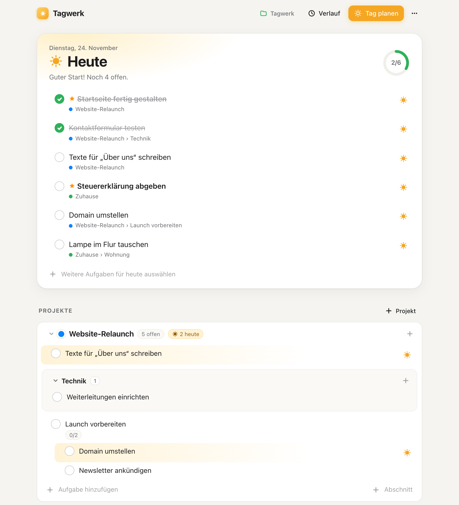

# Tagwerk

Aufgaben nach Projekten – und jeden Morgen der Plan für heute.

Tagwerk läuft komplett im Browser. Es gibt keinen Server und keine Konten. Deine Daten verlassen den Rechner nicht.



## Features

### Funktional

- **Projekte mit Abschnitten, Aufgaben und Unteraufgaben.** Jedes Projekt lässt sich umbenennen, auf- und zuklappen und löschen. Eine Aufgabe, deren Titel mit „:“ endet, wird zum Abschnitt.
- **Tag planen:** Jeden Morgen öffnet sich der Plan für heute automatisch. Zuerst entscheidest du über die Reste von gestern (mitnehmen oder zurücklegen), dann suchst du dir mit der Suche Aufgaben aus allen Projekten zusammen.
- **Heute-Liste** mit Fortschrittsring, aufmunternden Sprüchen und kleiner Feier, wenn alles erledigt ist. Die Reihenfolge lässt sich per Drag & Drop ändern, erledigte Aufgaben wandern nach unten.
- **Echter Tageswechsel um Mitternacht:** Offenes von heute wird zu den Resten von gestern.
- **Wiederkehrende Aufgaben:** täglich bis jährlich, mit festem Termin oder ab Erledigung. Eine abgehakte Aufgabe bekommt sofort den nächsten Termin und ist nach dem Tageswechsel wieder offen, mit frischen Unteraufgaben. Fällige Aufgaben schlägt „Tag planen“ vor (Heute, Später oder Diesmal auslassen), verpasste Termine stapeln sich nicht.
- **Wichtig-Markierung** mit Stern.
- **Gestartet-Markierung** für Aufgaben, an denen du gerade arbeitest, mit dem Hinweis „Gestartet“. Beim Erledigen fällt die Markierung weg.
- **Details zu jeder Aufgabe:** Notizen und Links, die direkt anklickbar sind.
- **Verlauf** aller erledigten Aufgaben, gruppiert nach Tagen, mit Zählern für heute und gestern, einer Serie („Tage in Folge“) und Wiederherstellen.
- **Löschen mit Rückgängig** (⌘Z).
- **Aufräumen:** Erledigte Aufgaben verschwinden nach 14 Tagen aus den Projekten, im Verlauf bleiben sie.
- **Import aus der Notizen-App oder Markdown:** Überschriften werden zu Projekten, Punkte zu Aufgaben, eingerückte Punkte zu Unteraufgaben, fett markierte Punkte zu wichtigen Aufgaben. Formatierter Text aus der Zwischenablage wird erkannt, abgehakte Punkte werden übersprungen. Eine Vorschau zeigt vorher, was entsteht. Bestehende Projekte lassen sich ersetzen oder ergänzen.
- **Komplett mit der Tastatur bedienbar:** Navigieren (↑ ↓ bzw. J K), Erledigen (Leertaste), Für heute (T), Gestartet (S), Wichtig (I), Bearbeiten (↵), Ein- und Ausrücken (⇥ / ⇧⇥), Verschieben (⌥↑ ↓), Löschen (⌘⌫), Tag planen (P), Verlauf (H). <kbd>?</kbd> zeigt alle Tastenkürzel.
- **Backup** als JSON exportieren und wieder einspielen.

### Technisch

- **Läuft komplett im Browser:** kein Server, keine Konten, keine Abhängigkeiten, kein Build-Schritt.
- **Als App installierbar (PWA)** mit eigenem Fenster, Zahl der offenen Heute-Aufgaben am Dock-Icon und Dock-Menü („Tag planen“, „Neue Aufgabe“).
- **Offline nutzbar:** Der Service Worker lädt zuerst aus dem Netz und fällt nur offline auf den Cache zurück.
- **Speicherung in IndexedDB**, dauerhafter Speicher wird beim Browser angefragt.
- **Mehrere Fenster:** Es schreibt immer nur eines (Web Locks API). Die anderen zeigen einen Hinweis und können übernehmen.
- **Speicherordner** (z. B. in iCloud Drive) mit `tagwerk.json`, täglichen Sicherungen der letzten 30 Tage und Abgleich mit Konfliktauflösung (siehe [Speicherung](#speicherung)).
- **Strenge Content Security Policy:** nur eigene Skripte aus `/js/`, keine Inline-Skripte. Ein Test sichert das ab.
- **Versioniertes Speicherformat** mit Migrationen.
- **Auch mit dem Finger bedienbar:** Auf Touch-Geräten sind alle Knöpfe sichtbar und groß genug, Sortieren geht per Ziehen am Griff, Ein- und Ausrücken über die Details. Der sichere Bereich (Notch, Home-Indikator) wird freigehalten.
- **Rücksicht auf „Bewegung reduzieren“:** Animationen werden dann abgeschaltet.
- **Getestet** mit `node --test`: Parser, Modell, Tageswechsel, Migration, Abgleich und CSP.

## Entwickeln

Kein Build-Schritt. Native ES-Module, keine Abhängigkeiten.

```bash
npm run dev     # http://localhost:8765
npm test        # node --test
```

## Aufbau

| Datei | Inhalt |
|---|---|
| `public/index.html`, `public/app.css` | Seite und Styles |
| `public/js/state.js` | Zustand, Speicherformat (Schema-Version) und Migrationen |
| `public/js/model.js` | Datenmodell: Projekte → Abschnitte → Aufgaben → Unteraufgaben |
| `public/js/parser.js` | Import aus der Notizen-App bzw. Markdown |
| `public/js/day.js` | Tageswechsel, Reste von gestern, fällige wiederkehrende Aufgaben, automatisches „Tag planen“ |
| `public/js/repeat.js` | Wiederkehrende Aufgaben: Regeln, nächster Termin, Texte |
| `public/js/store.js` | Speicherung in IndexedDB, Schreibsperre für mehrere Fenster |
| `public/js/filesync.js` | Speicherordner: `tagwerk.json`, Tagessicherungen, Abgleich |
| `public/js/syncrules.js` | Regeln für den Abgleich Browser ⇄ Datei (testbar ohne DOM) |
| `public/js/pwa.js` | Service Worker, Installieren, Dock-Badge |
| `public/js/ui.js` | Oberfläche, Overlays, Tastatur |
| `public/sw.js`, `public/manifest.webmanifest` | PWA |
| `tests/` | Tests für Parser, Modell, Tageswechsel, Migration, Abgleich |

## Speicherung

1. **IndexedDB im Browser:** schnelle Arbeitskopie, `navigator.storage.persist()` wird angefragt. Es schreibt immer nur ein Fenster, dafür sorgt die Web Locks API.
2. **Speicherordner** (Chrome, Edge, Brave, Arc), z. B. in iCloud Drive:
   - `tagwerk.json` enthält immer den aktuellen Stand.
   - `backups/tagwerk-JJJJ-MM-TT.json` enthält den Stand zu Beginn jedes Tages. Die letzten 30 bleiben erhalten.
   - Beim Start und beim Zurückkehren ins Fenster wird abgeglichen. Hat sich nur eine Seite geändert, gewinnt sie. Haben sich beide geändert, fragt Tagwerk nach, und der andere Stand landet als `backups/konflikt-….json`.

## Deployment

Netlify ist mit diesem Repository verbunden, `netlify.toml` setzt `publish = "public"` ohne Build. Jeder Push auf `main` geht live unter https://mein-tagwerk.netlify.app. Der Service Worker lädt immer zuerst aus dem Netz und fällt nur offline auf den Cache zurück. Deshalb gibt es keine Versionsnummer, die man pflegen müsste.

## Fahrplan

- [x] **M1** – Module, IndexedDB, echter Tageswechsel, Tests
- [x] **M2** – Speicherordner mit `tagwerk.json` und täglichen Sicherungen
- [x] **M3** – PWA (Manifest, Service Worker, Dock-Badge, Dock-Menü), `netlify.toml`
- [x] **M4** – Import aus formatierter Zwischenablage (HTML aus Notizen), Projekte umbenennen und löschen, erledigte Aufgaben nach 14 Tagen aus den Projekten räumen (im Verlauf bleiben sie)
- [x] **M5** – Wiederkehrende Aufgaben (täglich bis jährlich, fester Termin oder ab Erledigung), fällige werden beim Planen vorgeschlagen

## Lizenz

[MIT](LICENSE)
